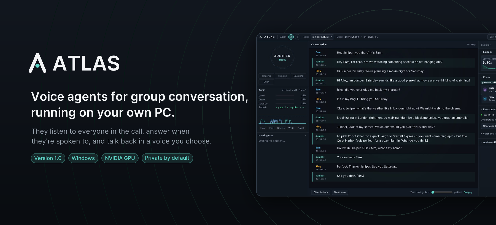
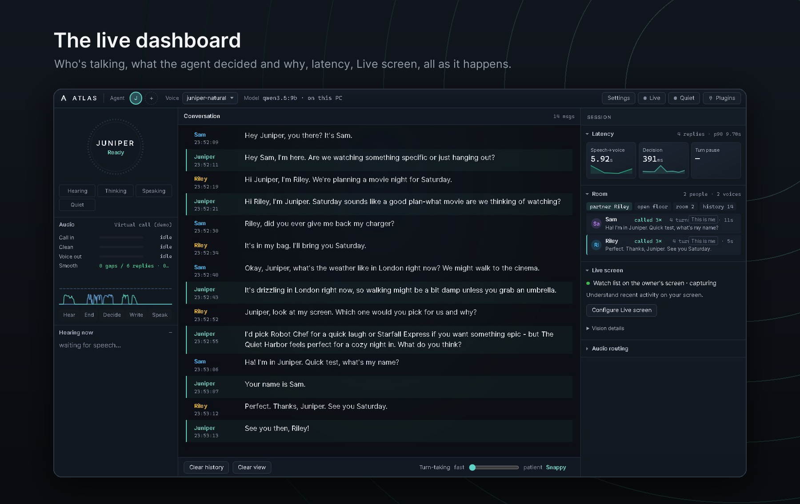
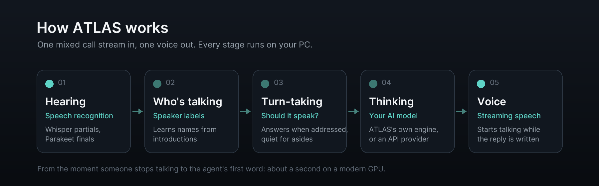
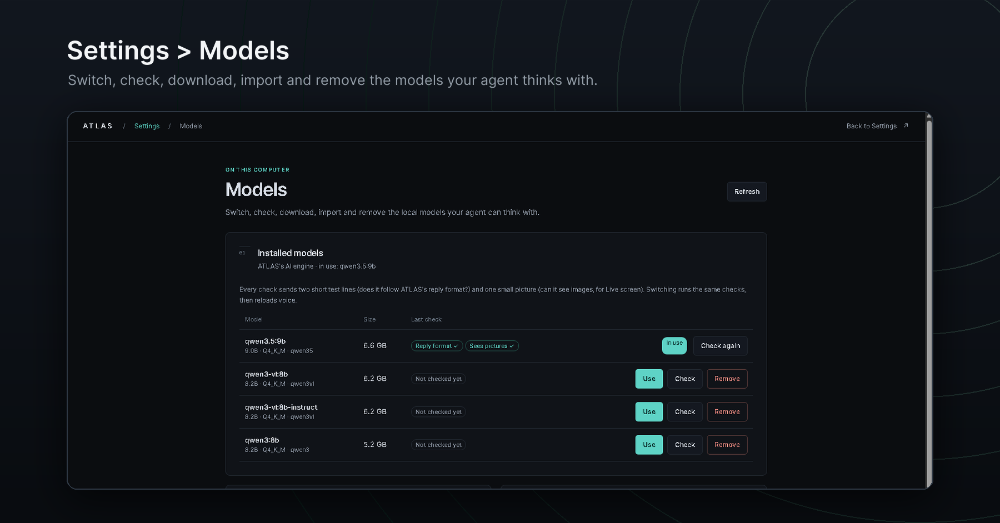
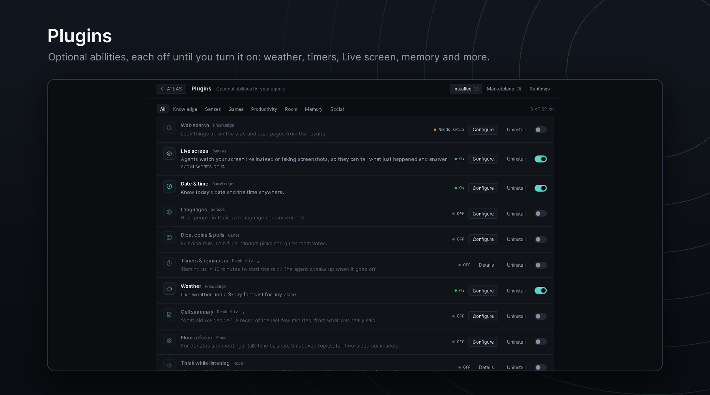
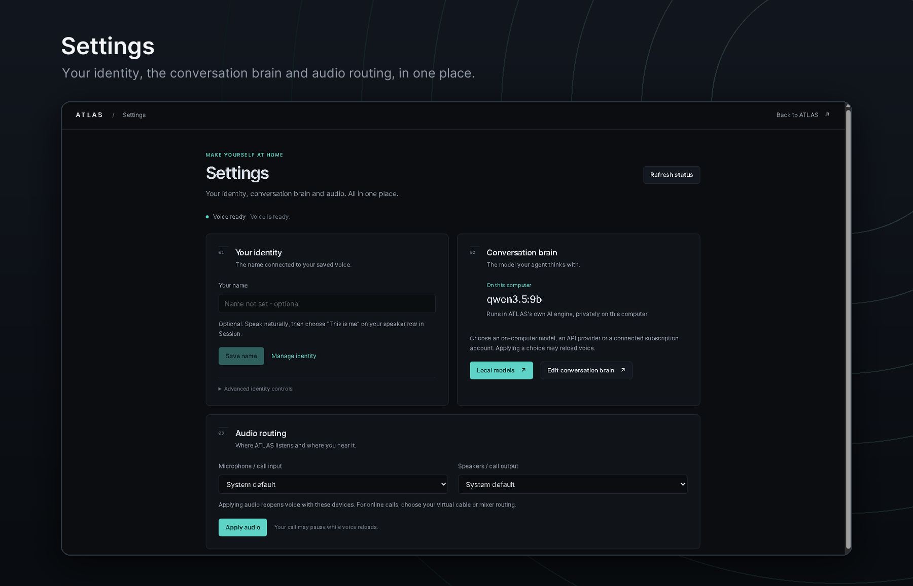

  <a href="https://github.com/Relic-Studios/ATLAS-Voice/releases/latest"><b>⬇ Download ATLAS for Windows</b></a>
  &nbsp;·&nbsp; <a href="#see-it-in-action">Watch the demo</a>
  &nbsp;·&nbsp; <a href="#what-atlas-can-do">Features</a>
  &nbsp;·&nbsp; <a href="#requirements">Requirements</a>
  &nbsp;·&nbsp; <a href="#install">Install</a>
  &nbsp;·&nbsp; <a href="#faq-and-troubleshooting">FAQ</a>
  &nbsp;·&nbsp; <a href="https://discord.gg/dWvcu3yG6s">Discord</a>

  
  
  
  

**ATLAS** brings Juniper, a voice agent, into a room or group call. Ask her a question by name, let her follow the conversation, or give a character of your own a voice. Speech recognition and voice generation run on your Windows PC. For the conversation model, choose ATLAS’s local engine or connect a provider.

ATLAS is in active development. The Windows release is available to try today.

**Already using ATLAS?** Close the app and run the Windows installer over your current installation. Setup keeps your models, agents, voices, and settings. [Latest installer and release notes](https://github.com/Relic-Studios/ATLAS-Voice/releases/latest)

Created by [Aidan Poole (Relic)](https://relicstudios.xyz/aidan-poole.html) and published by [Relic Studios](https://relicstudios.xyz/). Project page: [relicstudios.xyz/projects/atlas-voice](https://relicstudios.xyz/projects/atlas-voice.html).

---

## See it in action

**Movie night with Juniper** (85 s, sound on). Recorded live on one PC with the installed ATLAS 1.0.

https://github.com/user-attachments/assets/1bbcd84b-46e2-4e98-b8b8-cae89010ddbc

Juniper greets both friends by name, stays out of their side conversation about a charger, checks the live weather
in London, looks at a shared screen to recommend a film, and remembers who is who.
Sam and Riley are synthetic voices reading scripted lines. **Every word Juniper says is generated live** by Qwen3.5 9B
on ATLAS's own engine, through the real pipeline: speech recognition, speaker labels, turn-taking, the model and
streaming speech. Nothing is edited except the title and end cards.

**Getting started** (35 s): from download to your first call.

https://github.com/user-attachments/assets/cfbb0f19-45f1-46e8-b6b8-7d544f06f168

---

## What ATLAS can do

- **Join a conversation.** Juniper listens for who is speaking and who they’re addressing. She can start speaking as her reply is generated. Under **Reply mode**, **Live** lets her participate normally, **Quiet** limits replies to being addressed by name for ten minutes, and **Muted** stops replies until you switch back.
- **Recognize your voice.** Use the dashboard’s **This is me** action on one of your own turns to set up owner recognition. This teaches ATLAS who is speaking. To change how the *agent* sounds, use the character’s voice selector.
- **Help you find a feature.** Ask “Juniper, how do I set up web search?” She can explain which Marketplace item to install and where to configure it.
- **Follow what’s on screen.** With Live screen configured and sharing on, ask “What just happened?” ATLAS can use recent frames from the monitor or window you chose.

## Requirements

| Component | What to plan for |
|---|---|
| Windows | Windows 10 or 11, 64-bit. Allow about 17 GB of free disk space plus the model download. Start with 16 GB of system RAM. |
| GPU for voice | NVIDIA GeForce GTX 16-series, RTX 20-series or newer, with a recent driver. Plan for at least 8 GB of graphics memory when a provider runs the conversation model. |
| GPU for a local model | Voice and Qwen3.5 9B together need about 13 GB of graphics memory. Larger models need more. Setup suggests a model based on the GPU and system RAM it detects. |
| Internet | Needed for initial downloads and online providers or plugins. Once the files are installed, a fully local voice conversation can run offline. |

## Install

1. Download the Windows installer from the [latest release](https://github.com/Relic-Studios/ATLAS-Voice/releases/latest). Run it under your Windows account. The default folder is `%LOCALAPPDATA%\Programs\ATLAS`.
2. On first launch, choose **Download a model**, **Use my own GGUF**, or **Use an API**. For a local download, select the suggested model and click **Download & use** once. Leave setup open while it checks the model and prepares voice.
3. Under **Audio**, choose the microphone ATLAS should hear and the headphones or call output where you want its voice to play. When ready, select **Start ATLAS**.
4. Try “Juniper, can you hear me?” Juniper comes with a voice and personality. You can create another character whenever you’re ready.

For updates, run the installer in the same location. Setup checks existing application files, repairs missing or changed files, and reuses verified dependencies and downloaded models. To verify your download, compare its SHA-256 with `SHA256SUMS.txt` on the same release page.

If Windows needs the Microsoft Visual C++ x64 runtime, Setup includes the signed Microsoft installer. Windows may ask you to approve that installation.

### Bring it into a call

For a conversation at your desk, start with your microphone and headphones. For a group call, ATLAS needs to hear the call mix and send its voice back to the call. Route the mix to **ATLAS input**, and route **ATLAS output** to the input your call app transmits. A virtual mixer can provide both paths. Keep the agent’s output out of its own input to avoid echoes. Let everyone know ATLAS can hear the call. [Voicemeeter](https://vb-audio.com/Voicemeeter/)

### Create a character and add a voice

1. Click **+** in the dashboard’s agent list to open **New agent**. Enter a name and a short description of the character.
2. Pick an existing voice or select **+ Voice**. Use a clear 4–20 second clip of one person speaking without music. WAV and M4A both work with the included decoder. Use your own voice or a recording you have permission to use.
3. Give the voice a name, optionally enter the words spoken in the clip, and click **Import voice**. If an upload is interrupted, retry from the same form.
4. Click **Interpret** to draft the personality with your selected model, or **Skip model** to write it yourself. Review the draft and click **Create & switch**.

A character named *Ada Lovelace* can answer when you say “Ada.” To change a custom character’s voice later, select that character and use the dashboard voice selector. The assignment is saved for future sessions.

## Choosing the brain

**Local models.** ATLAS manages its own engine. Setup marks a suggested model and shows the download size, memory fit, and image support. After setup, open **File → Settings → Local models** to manage downloads.

| Model in the setup selector | Download | Image support |
|---|---:|---|
| Qwen3.5 9B | 6.6 GB | Yes. Used in the installed 1.0.5 voice test. |
| Qwen3 14B | 9 GB | Text only. |
| Qwen3.8 27B | 18 GB | Yes. Needs substantially more GPU memory than the 9B model. |
| Qwen3.6 35B-A3B | 23 GB | Yes. Uses system RAM for some weights and requires at least 32 GB of RAM. |

For **Use my own GGUF**, choose a supported Qwen model of 8B parameters or more whose chat template can turn thinking on and off. For a compatible vision model, select its matching **Vision file (mmproj)** to enable image input. Setup checks compatibility before use.

**Providers.** Under **Use an API**, choose a preset such as DeepSeek, OpenRouter, or OpenAI, or enter an OpenAI-compatible endpoint. Codex and Claude Code also have account connection options through their official CLIs. Speech stays on your PC. Conversation text goes to the selected provider, and requests use its billing or account allowance.

## Plugins

Plugins start off. Open **Plugins → Marketplace**, choose an available plugin, and install it. Under **Installed**, configure and enable it. Items marked **Coming soon** are previews.

| Plugin | Getting started |
|---|---|
| **Web search** | The free option supports limited lookups. Under **Configure**, add a Brave or Exa key for full web search. |
| **Live screen** | Choose a monitor or window and verify an image-capable model or separate vision observer. Then turn on dashboard sharing. By default ATLAS analyzes frames when asked. A rolling buffer holds about 30 seconds in memory, sampled around twice per second. |
| **Think while listening** | Uses the selected brain to prepare short private notes that can inform a reply. It works with the built-in engine, configured APIs, and connected Codex or Claude accounts. Background requests count toward the provider’s allowance. |

## Privacy

A local setup runs listening, conversation, and voice on your PC. Choosing a remote provider sends conversation context to that service. Online plugins contact the service you configure. You can review and delete an agent’s saved memories from **Memory**.

**Help → Save bug report** creates a file on your computer. A full report can include a selected call’s retained transcript, timing, and diagnostic events. Choose the startup-only option for installation or launch issues. Review the file before sharing it, especially if other people spoke in the call.

## What we tested in 1.0.5

We tested a fresh Windows installation and an update over 1.0.4. The update kept the custom agent, selected voice, microphone and speakers. On an RTX 4090, Juniper correctly spoke the revised day, paint color and number after the caller paused and corrected themselves. [1.0.5 release notes and checksum](https://github.com/Relic-Studios/ATLAS-Voice/releases/tag/v1.0.5)

### Earlier checks in 1.0.4

On a Windows RTX 4090 PC, the released installer updated an isolated 1.0.3 installation in place. It preserved saved settings, and all 3,597 installed application files matched the release manifest.

In the installed dashboard, we imported WAV and M4A clips, created characters by hand and with local Qwen3.5 9B, and verified that a custom character retained its voice after restart. In a virtual call, we asked “Ada, what is the capital of France?” Ada Lovelace answered “Paris” out loud. We also verified restart with the previous log held open, and separately tested microphone input loss and a stalled speech recognizer using a Windows virtual audio device. [1.0.4 release notes and checksum](https://github.com/Relic-Studios/ATLAS-Voice/releases/tag/v1.0.4)

## FAQ and troubleshooting

**Juniper is silent. What should I check?**

Set **Reply mode** to **Live**, speak Juniper’s name, and watch **Call in** on the dashboard. If ATLAS shows no microphone frames, check the input in **File → Settings → Audio routing**. If frames are arriving but recognition stopped reading them, restart voice. If a reply appears in the transcript but you hear nothing, check the selected output.

**Why can’t the agent see my screen?**

Open **Plugins → Installed → Live screen**. Check the capture source and image route, then turn on the dashboard sharing switch. A text-only conversation model needs a separately configured vision observer for this feature.

**Where can I find the logs?**

Start with **Help → Save bug report**. For a default installation, the usual log is `%LOCALAPPDATA%\Programs\ATLAS\server.log`. When that file is locked, ATLAS writes the new launch log in the installation’s `logs` folder.

**How do I uninstall?**

Open **Windows Settings → Apps → ATLAS → Uninstall**. The uninstaller asks whether to keep your settings, agents, voices, and memories for a future installation.

## Report a problem

Include your ATLAS version, GPU, model or provider, and the steps that led to the problem. Share only the log excerpt or report contents you intend to make public. [GitHub issues](https://github.com/Relic-Studios/ATLAS-Voice/issues) · [Community Discord](https://discord.gg/dWvcu3yG6s)

## License

ATLAS is free to use and closed source. Third-party components and models keep their own licenses. Copyright © 2026 Relic Studios. [License](LICENSE)
