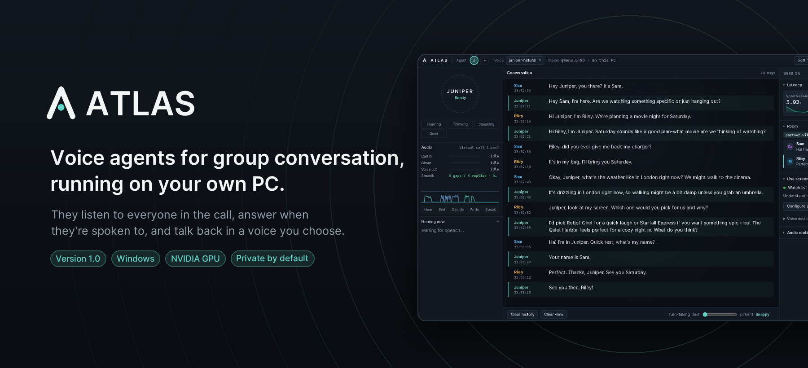
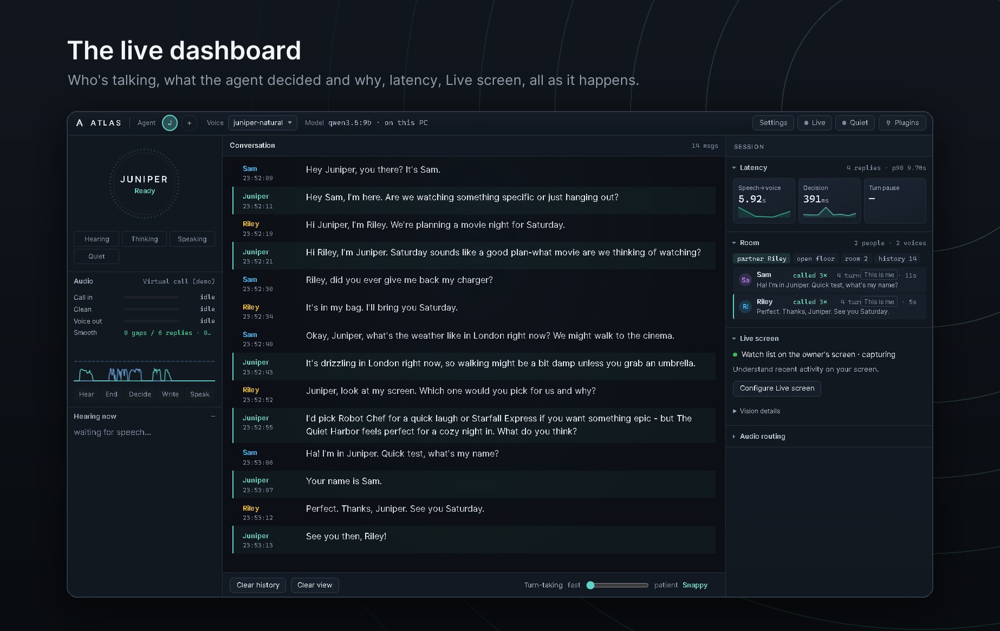
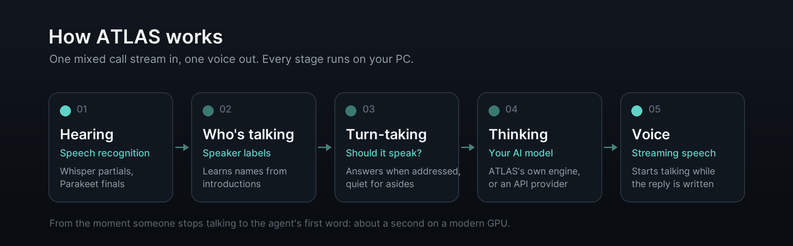
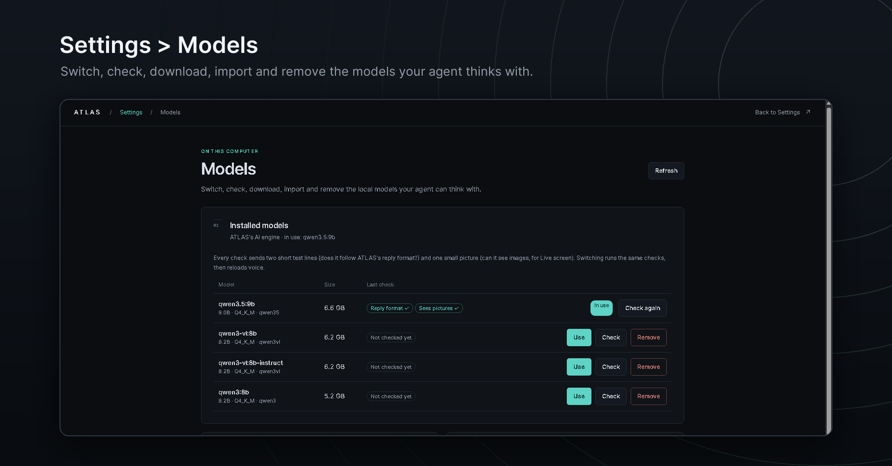
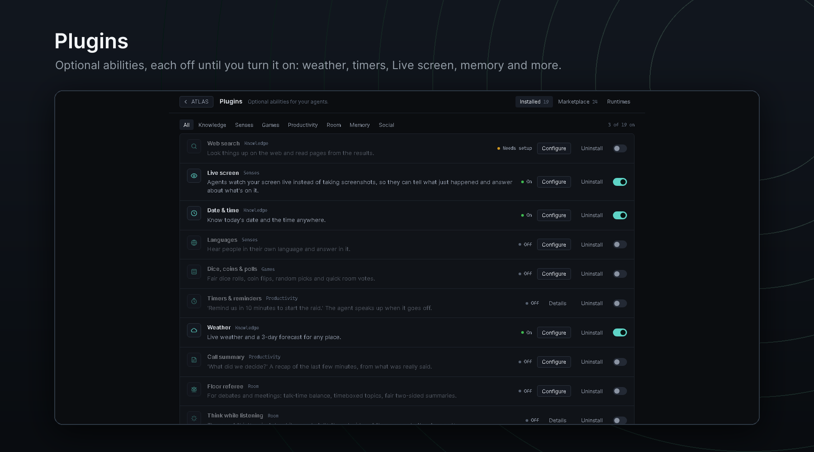
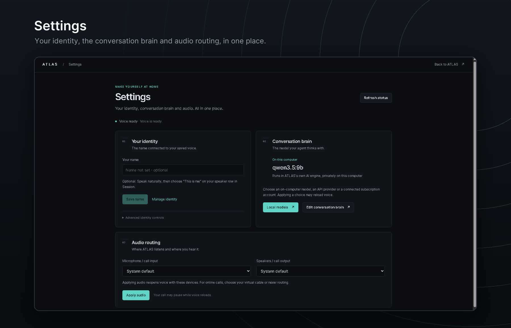

<p align="center"></p>

<p align="center">
  <a href="https://github.com/Relic-Studios/ATLAS-Voice/releases/latest"><b>⬇ Download ATLAS 1.0 for Windows</b></a>
  &nbsp;·&nbsp; <a href="#see-it-in-action">Watch the demo</a>
  &nbsp;·&nbsp; <a href="#what-atlas-can-do">Features</a>
  &nbsp;·&nbsp; <a href="#requirements">Requirements</a>
  &nbsp;·&nbsp; <a href="#install">Install</a>
  &nbsp;·&nbsp; <a href="#faq-and-troubleshooting">FAQ</a>
  &nbsp;·&nbsp; <a href="https://discord.gg/dWvcu3yG6s">Discord</a>
</p>

<p align="center">
  
  
  
  
</p>

**ATLAS** puts an AI voice agent into your group calls. It listens to everyone in the room or call, works out who
is talking, answers when it's spoken to, stays quiet when it isn't, and talks back in a voice you choose.
Listening, the voice and the AI model all run on your own graphics card: no account, no telemetry, no bundled keys.

---

## See it in action

**Movie night with Juniper** (85 s, sound on). Recorded live on one PC with the installed ATLAS 1.0.

https://github.com/Relic-Studios/ATLAS-Voice/raw/main/media/atlas-1.0-demo.mp4

Juniper greets both friends by name, stays out of their side conversation about a charger, checks the live weather
in London, looks at a shared screen to recommend a film, and remembers who is who.
Sam and Riley are synthetic voices reading scripted lines. **Every word Juniper says is generated live** by Qwen3.5 9B
on ATLAS's own engine, through the real pipeline: speech recognition, speaker labels, turn-taking, the model and
streaming speech. Nothing is edited except the title and end cards.

**Getting started** (35 s): from download to your first call.

https://github.com/Relic-Studios/ATLAS-Voice/raw/main/media/atlas-1.0-getting-started.mp4

---

## What ATLAS can do

<p align="center"></p>

| | |
|---|---|
| **Group conversation** | Built for calls with several people. It answers when it's addressed, by name or by context, and stays out of conversations that aren't for it. Short in banter, fuller when you ask it something real. |
| **Knows who's who** | Labels each speaker and learns names from introductions, so it's "Sam" and "Riley", not "Speaker 3". Optional owner recognition lets it pick out your voice in later calls. |
| **Fast, natural voice** | It starts speaking while the reply is still being written. In our 1.0 test runs the median time from the end of a question to the agent's first word was about a second. |
| **Your voice, your agent** | Juniper and her voice are ready on first launch. Make your own agent from a 10–20 second voice clip and a short description of the personality; ATLAS drafts it and you edit it. |
| **Runs on your PC** | ATLAS installs its own private AI engine. The recommended model, Qwen3.5 9B, downloads during setup, or bring your own `.gguf`. |
| **Sees your screen** | With Live screen on, ask "what's on my screen?" and the agent looks at the window you chose to share. |
| **Abilities you choose** | 20 plugins: weather, date and time, timers, dice and polls, call summaries, live translation, game info, memory tools and more. Every one is off until you turn it on. |
| **Remembers calls, not people** | Each agent keeps short memories of the calls it was in. Names are taken out before anything is stored, and you can view and delete memories at any time. |
| **You stay in control** | Instant mute, quiet mode, a turn-taking slider from snappy to patient, mute a specific speaker, and a report after each conversation. |

<p align="center"></p>

---

## Requirements

| | |
|---|---|
| **System** | Windows 10 or 11 (64-bit), 16 GB RAM, about 17 GB free disk plus your model |
| **Graphics card** | NVIDIA GeForce GTX 16-series, RTX 20-series or newer, with a recent driver. Setup checks your card and driver before it downloads anything. |
| **Internet** | For the install and model download. After that a fully local setup runs offline; plugins like Weather need the internet. |

| Graphics memory | What you get |
|---|---|
| **16 GB or more** (e.g. RTX 4080, 4090, 5080, 5090) | **Fully local.** Listening, voice and the AI model on your PC, with the recommended Qwen3.5 9B or your own model. |
| **8–15 GB** (e.g. RTX 3060, 4060, 4070) | **ATLAS with an API provider** for the AI model. Listening and the voice still run on your PC. |

Listening and the voice use about 6 GB of graphics memory; the recommended model uses about 7.5 GB more.
12 GB cards can't fit a local model next to the voice yet; we're working on it.

---

## Install

1. **Download** `ATLAS-Setup-1.0.0.exe` (145 MB) from the
   [latest release](https://github.com/Relic-Studios/ATLAS-Voice/releases/latest).
2. **Run it.** No admin rights needed. ATLAS installs into your own Program Files
   (`%LOCALAPPDATA%\Programs\ATLAS`) with its own copy of Python and the desktop app, so there's nothing else to
   install. Setup shows each step, how much is downloaded and the time left. **Stop** is always available; run Setup
   again and it finishes what's left.
3. **First launch** is one page with two choices:
   - **The brain:** download the recommended model, import your own `.gguf` file, or choose an API provider.
     ATLAS checks the model (chat format, thinking switch, vision), loads it and warms it up, so the first reply
     has no wait.
   - **Audio:** the microphone or call input the agent listens to, and where it speaks.
4. Press **Start ATLAS** and say "Hey Juniper".

> **SmartScreen:** the installer isn't code-signed yet, so Windows may say it's an unrecognized app. Click
> **More info → Run anyway**. You can check the file against `SHA256SUMS.txt` on the release page:
> ```powershell
> Get-FileHash .\ATLAS-Setup-1.0.0.exe -Algorithm SHA256
> ```

**Update:** run the new Setup over the old install. Settings, agents, voices and models are kept.<br>
**Uninstall:** Windows Settings › Apps › **ATLAS** › Uninstall, or **Uninstall ATLAS** in the Start menu. It asks
whether to keep your data (settings, voices, agents, memories) for a later reinstall.

### Bring it into a call

ATLAS works from one mixed audio stream, the same thing you'd hear in the call. To use it in Discord or any other
voice app, route the call's audio into a virtual audio cable (for example
[VB-Audio Voicemeeter](https://vb-audio.com/Voicemeeter/)), pick that cable as ATLAS's input, and pick the cable
that feeds your call as its output. To talk with it in the room instead, use your microphone and speakers.

Tell everyone in the call before you bring an agent in: it hears all of them.

---

## Choosing the brain

<p align="center"></p>

**On your PC (recommended).** ATLAS runs models in its own private engine on its own port. It never touches an
Ollama or other AI tools you already have. Manage them any time in **Settings › Models**: switch with a check,
download by name, import a `.gguf`, or remove one.

| Model | Size | Notes |
|---|---|---|
| **Qwen3.5 9B** | 6.6 GB | Recommended. Sees your screen. |
| Qwen3 8B | 5 GB | Text only (no Live screen). |
| Qwen3.5 27B | 17 GB | Sees your screen; needs a much bigger card. |

A model must be 8B or larger and have a thinking switch in its chat template: ATLAS answers with thinking off and can
think while listening. Setup refuses models that can't, and tells you why before copying anything.

**API provider (limited).** Any OpenAI-compatible provider (for example OpenRouter, Together, Groq or OpenAI) with
your own key, or a Claude Code or Codex subscription account through its official sign-in. It works, but with
trade-offs: no full think-while-listening, slower replies than on your PC, it costs money, and the conversation goes
to that company. Keys are stored only on your PC.

---

## Plugins

<p align="center"></p>

Every plugin starts off. Turn on only what you want in **Plugins**.

| Category | Plugins |
|---|---|
| **Knowledge** | Web search (needs a free Exa or Brave key) · Date & time · Weather · Quiet fact-check |
| **Senses** | Live screen · Languages · Live translate · Room-energy sense |
| **Room** | Think while listening · Floor referee |
| **Productivity** | Timers & reminders · Call summary |
| **Memory** | Teach-me mode · Lore keeper · Soul reflection · Notes & follow-ups |
| **Games** | Dice, coins & polls · Game info (live Steam prices and player counts) |
| **Social & creative** | Step back · Highlight reel |

---

## Privacy

<p align="center"></p>

- **Local by default.** With a local model, listening, thinking and speaking all happen on your PC. The ATLAS server
  listens on this computer only and rejects requests from web pages.
- **No account, no telemetry, no bundled keys.**
- **Memories are about calls, not people.** They're made after a call ends, on your PC. Names of the people in the
  call are taken out first, and phone numbers, emails, addresses and keys are never stored. Say "remember that…",
  "forget that" or "off the record". Open an agent's **Memory** window to see or delete what it keeps.
- **API providers only get what they need** for replies, and background memory processing goes to them only if you
  tick **Allow cloud processing**.
- **Consent:** only clone your own voice, or a voice whose owner agreed. Don't impersonate real people.

---

## What we tested for 1.0

ATLAS 1.0 was qualified with a full automated run on the release build: a fresh install of the actual installer,
first-run setup, every plugin, and a scripted group conversation through the real pipeline.

| | Result |
|---|---|
| **Install** | Silent install from `ATLAS-Setup-1.0.0.exe`, all 145 app modules compiled, AI engine checksum verified |
| **First run** | Model downloaded, checked (chat format, thinking on/off, vision) and warmed; voice ready 0.24 s after Start |
| **Plugins** | 17 passed their own tests; Web search (needs a key), Live screen (covered in the conversation) and Highlight reel (separate runtime) were not tested automatically. None failed. |
| **Conversation** | Every scripted check passed: answered when addressed, stayed quiet for asides and when told to, came back when invited, read a number off the shared screen |
| **Speed** | Time to first audio: median 970 ms, P90 1.44 s (RTX 4090, Qwen3.5 9B) |
| **Memory use** | Peak 13,975 MiB (about 13.6 GB) of graphics memory for voice plus model, nothing spilled into shared memory |
| **Dependencies** | No known vulnerabilities (pip-audit, npm audit) |

Overall: 76 checks passed, 0 failed. Testing so far is on a Windows RTX 4090 PC; other hardware hasn't had much
testing yet, so your bug reports really help.

---

## FAQ and troubleshooting

<details>
<summary><b>Setup says my graphics card isn't supported.</b></summary>

ATLAS needs an NVIDIA GTX 16-series, RTX 20-series or newer with at least 8 GB of graphics memory. GTX 10-series
(Pascal) and older cards, and AMD or Intel graphics, aren't supported. If Setup says your driver is too old, update it
from [nvidia.com/drivers](https://www.nvidia.com/drivers) (free).
</details>

<details>
<summary><b>"This model can't run ATLAS."</b></summary>

The model's chat template has no thinking switch, or it's smaller than 8B. Choose a Qwen model that has one, such as
`qwen3.5:9b`. Thinking-only builds are refused on purpose: they're too slow to answer in a live call.
</details>

<details>
<summary><b>The agent doesn't answer.</b></summary>

Check the **Audio** panel on the dashboard: **Call in** should move when people talk. If it doesn't, pick the right
input in **Settings › Audio routing**. Say the agent's name the first time. If the turn-taking slider is set to
patient, it waits longer before it speaks.
</details>

<details>
<summary><b>Where are the logs?</b></summary>

`server.log` in `%LOCALAPPDATA%\Programs\ATLAS`; earlier launches are in its `logs` folder.
</details>

<details>
<summary><b>Can I use it on Linux or macOS?</b></summary>

ATLAS 1.0 is Windows only.
</details>

<details>
<summary><b>Is it open source?</b></summary>

No. ATLAS 1.0 is free to use and closed source; see [LICENSE](LICENSE). This repository holds the official releases.
</details>

---

## Report a problem

Open a [GitHub issue](https://github.com/Relic-Studios/ATLAS-Voice/issues) with your graphics card, the model or
provider you use, what happened, and the relevant part of the log. Remove anything private first, and never include
API keys or call recordings. Questions, tips and clips go in the
[community Discord](https://discord.gg/dWvcu3yG6s).

## License

ATLAS is free to use and closed source. See [LICENSE](LICENSE). Third-party components and models keep their own
licenses. Copyright © 2026 Relic Studios.
