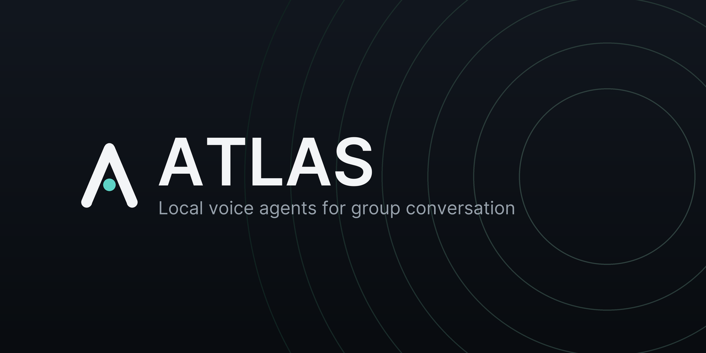
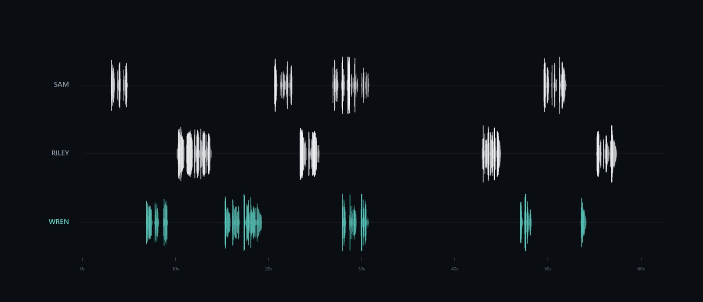

  <a href="https://github.com/Relic-Studios/ATLAS-Voice/releases/latest"><b>Download ATLAS for Windows</b></a> ·
  <a href="#requirements">Requirements</a> ·
  <a href="#install">Install</a> ·
  <a href="https://github.com/Relic-Studios/ATLAS-Voice/issues">Report a bug</a> ·
  <a href="https://discord.gg/dWvcu3yG6s">Community Discord</a>

# ATLAS

Voice agents for group conversation, running on your PC. They listen to everyone in the room or call, answer when
they're talked to, and speak in a voice you choose. Listening, the voice and the AI model can all run locally: no
account, no telemetry, no bundled API keys.

  

- **Runs on your PC.** Listening, the voice and the AI model run on your own graphics card. ATLAS installs its own
  private AI engine. If you'd rather use an API provider, you can do that instead.
- **Your voice, your agent.** Import a 10–20 second clip, describe a personality, and ATLAS drafts the agent for you
  to edit.
- **Knows when to talk.** In a group it answers when it's addressed and stays quiet when it isn't. Short in banter,
  fuller when you ask it something real.
- **Learns names** from introductions instead of calling people "Speaker 3".
- **Remembers the calls, not the people.** Each agent keeps short memories of the calls it was in, and facts only
  about you. You can view and delete them at any time.
- **You stay in control.** Instant mute, quiet mode, a talkativeness slider, mute a specific speaker, and a report
  after each conversation.

## Requirements

- Windows 10 or 11, 64-bit.
- An NVIDIA GeForce GTX 16-series, RTX 20-series or newer, with a recent driver. Setup checks your card and driver
  before it downloads anything.

| Graphics memory | What works |
|---|---|
| 8–15 GB | ATLAS with an API provider for the AI model (listening and the voice still run on your PC) |
| 16 GB or more | Fully local, with the recommended model (Qwen3.5 9B) or your own `.gguf` |

## Install

1. Download **ATLAS-Setup-1.0.0.exe** from the [latest release](https://github.com/Relic-Studios/ATLAS-Voice/releases/latest)
   and run it. No admin rights are needed. ATLAS installs into your own Program Files
   (`%LOCALAPPDATA%\Programs\ATLAS`) with everything it needs, so you don't need Python or anything else.
2. Setup installs the runtime, the speech and voice models and the AI engine, showing each step and the time left.
   **Stop** is always available; run Setup again to finish what's left.
3. On first launch, choose the AI model (download the recommended one, pick your own `.gguf` file, or choose an API
   provider), then your microphone and speakers. ATLAS checks and warms the model, then you're ready.

> Windows may show a SmartScreen warning because the installer isn't code-signed yet. Click
> **More info → Run anyway**. Check the file against `SHA256SUMS.txt` on the release page:
> `Get-FileHash .\ATLAS-Setup-1.0.0.exe -Algorithm SHA256`

**Update:** run the new Setup over the old install. Your settings, agents, voices and models are kept.

**Uninstall:** Windows Settings > Apps > **ATLAS** > Uninstall, or **Uninstall ATLAS** in the Start menu. It asks
whether to keep your data (settings, voices, agents, memories) for a later reinstall.

## Good to know

- **API providers are limited:** no full think-while-listening, slower replies, they cost money, and the
  conversation goes to that company.
- **Consent:** only clone your own voice, or a voice whose owner agreed. Tell everyone in a call before you bring an
  agent in: it hears all of them.
- ATLAS 1.0 is tested on a Windows RTX 4090 PC. Other hardware hasn't had much testing yet, so bug reports are very
  welcome.

## Reporting a problem

Open a [GitHub issue](https://github.com/Relic-Studios/ATLAS-Voice/issues) with your graphics card, the AI model or
provider, what happened, and the relevant part of the log (`server.log` in `%LOCALAPPDATA%\Programs\ATLAS`; earlier launches are in its
`logs` folder). Remove anything
private first, and never include API keys or call recordings. Questions and tips go in the
[community Discord](https://discord.gg/dWvcu3yG6s).

## License

ATLAS is free to use and closed source. See [LICENSE](LICENSE). Copyright (C) 2026 Relic Studios. Third-party
components and models keep their own licenses.

This repository holds the official releases only; the source code is not published.
